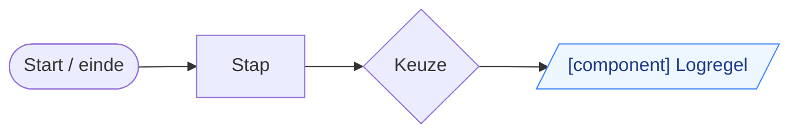
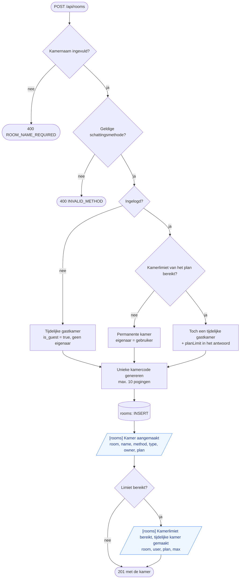
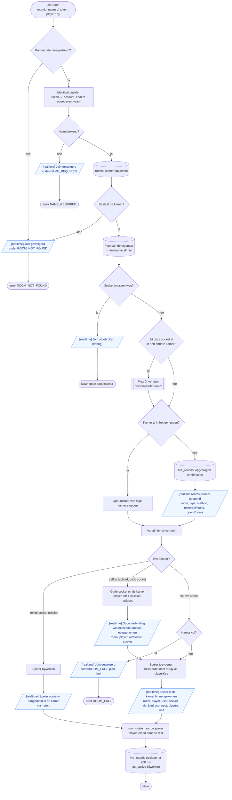
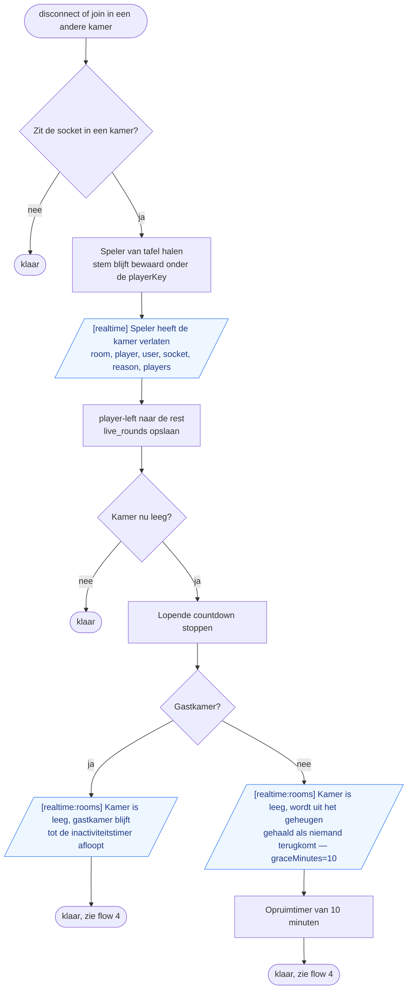
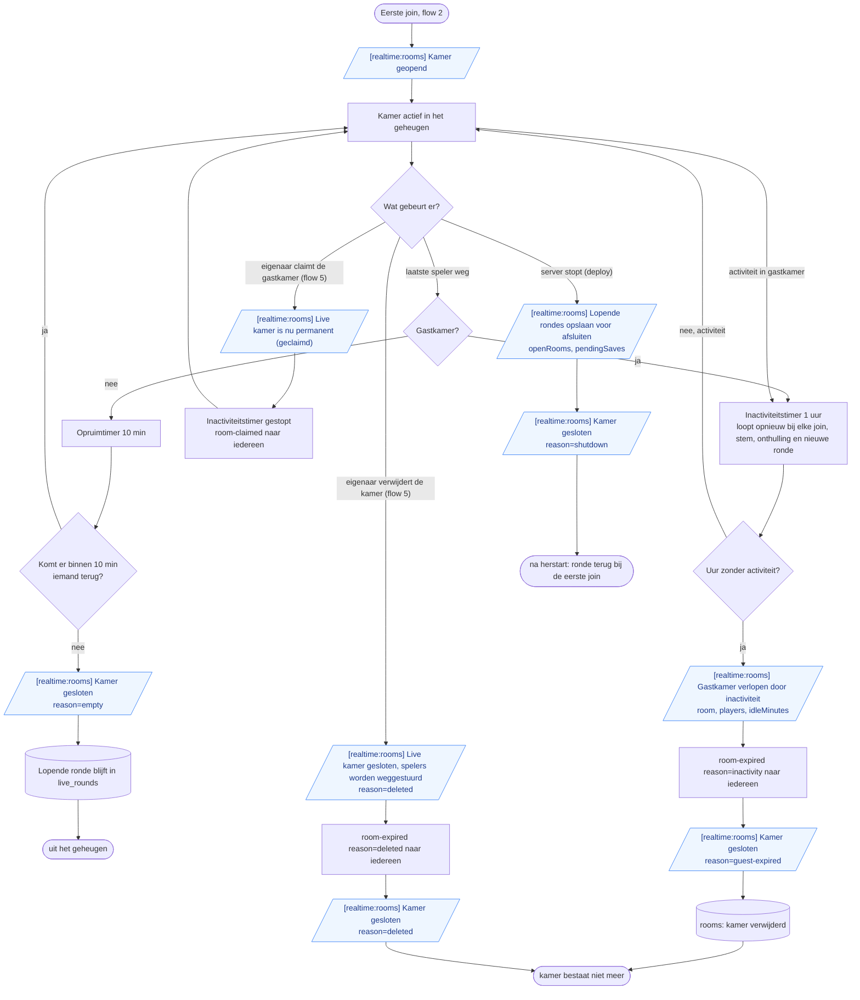
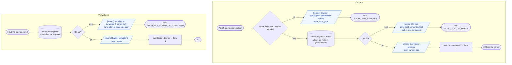
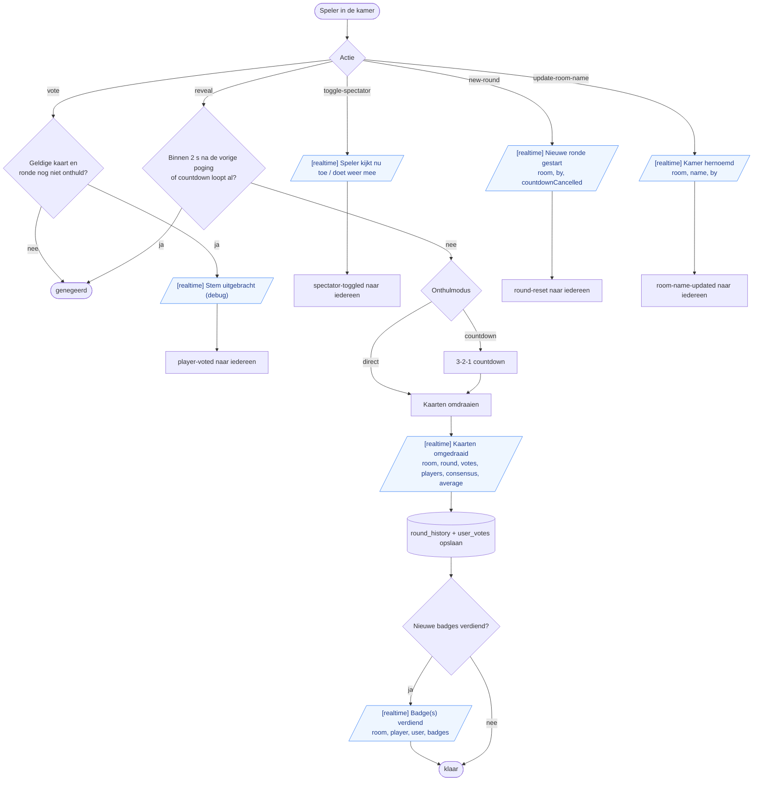
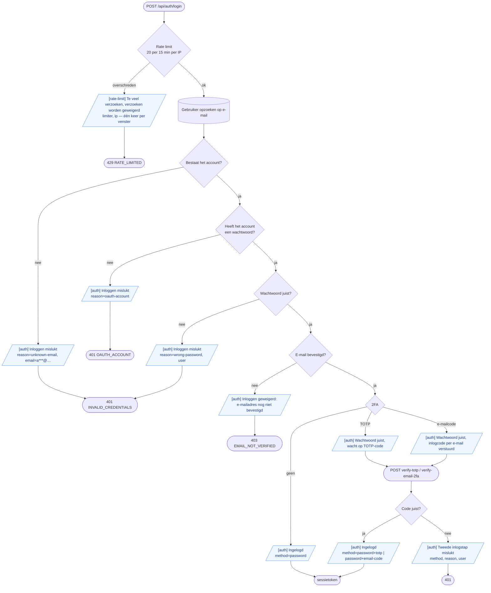

# Kamerflows — activiteitendiagrammen en logging

Dit document laat met activiteitendiagrammen zien wat de backend doet als een kamer wordt aangemaakt, als spelers joinen of weggaan, hoe een kamer in het geheugen leeft en weer verdwijnt, en wat er bij inloggen gebeurt. Bij elke stap staat welke logregel de backend schrijft, zodat je in `docker logs`, de workflow **Backend logs** of Seq kunt volgen wat er gebeurt.

De volgorde van berichten tussen browser, server en database staat in de sequence-diagrammen van [`spelscenarios.md`](spelscenarios.md). Dit document gaat over de beslissingen en de logging aan de serverkant.

**Legenda**



Blauwe parallellogrammen zijn logregels. Het deel tussen `[` en `]` is de component; die staat in Seq als property `Component`.

---

## Logging in het kort

Alle backendcode logt via `backend/src/shared/logger.js`:

```js
const { createLogger } = require('../shared/logger');
const log = createLogger('realtime');

log.info('Speler is de kamer binnengekomen', { room: id, player: name, players: 3 });
log.error('Opslaan mislukt', { room: id }, err); // een Error als laatste argument logt de stacktrace mee
```

Dat geeft één regel per gebeurtenis, altijd in dezelfde vorm:

```
[realtime] Speler is de kamer binnengekomen  room=K7M2QX player=Alice user=guest socket=sQ1x… via=join players=3 limit=7
```

- **Vorm:** `[component] Bericht  veld=waarde veld=waarde`. Waarden met spaties of `=` staan tussen aanhalingstekens (`player="Account Alice"`). Lege velden worden weggelaten.
- **Seq:** de velden gaan ook als losse properties mee, dus je kunt filteren op bijvoorbeeld `room = 'K7M2QX'` of `Component = 'realtime' and player = 'Alice'`. Elke soort regel heeft daarnaast:
  - een vast **eventtype** (`@EventType`, 8 hex-tekens, afgeleid van component + bericht). Alle "Speler is de kamer binnengekomen"-regels hebben hetzelfde type, wat de velden ook zijn. Zo kun je in Seq per soort tellen, grafieken maken en signalen instellen;
  - de property **`Event`**: het bericht zonder velden, om leesbaar op te filteren: `Event = 'Speler is de kamer binnengekomen'`.
- **Persoonsgegevens:** log nooit een volledig e-mailadres, wachtwoord, token of code. Gebruik `maskEmail()` uit de logger (`jan.jansen@example.nl` → `j***@example.nl`) en identificeer gebruikers met hun id (`user=`). Bij HTTP-fouten wordt alleen het pad gelogd, zonder querystring, omdat daar tokens in kunnen staan. Spelernamen staan wel in de logs, omdat je anders niet kunt zien wie er joint of weggaat.
- **Niveaus:** `debug` < `info` < `warn` < `error`. `LOG_LEVEL` in de omgeving bepaalt vanaf welk niveau er gelogd wordt; standaard `info`, in de tests `error`. Met `LOG_LEVEL=debug` zie je ook stemmen, socketverbindingen en rondenamen.
- **Vaste velden:**

| Veld | Betekenis |
|---|---|
| `room` | Kamercode, bv. `K7M2QX` |
| `player` | Weergavenaam van de speler |
| `user` | Gebruikers-id, of `guest` voor een speler zonder account |
| `socket` | Socket-id van de verbinding (één per tabblad) |
| `players` | Aantal spelers aan tafel ná de gebeurtenis |
| `openRooms` | Aantal kamers in het geheugen van de server ná de gebeurtenis |
| `reason` | Waarom iets gebeurt (`disconnect: transport close`, `switch-room`, `empty`, `deleted`, …) |
| `code` | Foutcode zoals de client hem krijgt (`ROOM_NOT_FOUND`, `ROOM_FULL`, …) |
| `req` | Request-id van het HTTP-verzoek waarbinnen de regel geschreven is (zie hieronder) |

**Componenten:** `rooms` (REST: aanmaken, claimen, verwijderen), `realtime` (socket-handlers: joinen, verlaten, spelacties), `realtime:rooms` (levenscyclus van kamers in het geheugen), `socket`, `http`, `server`, `db`, `jobs:*`, `billing`, `mail`, `auth` (inloggen, registreren, 2FA), `admin` (auditlog van adminacties), `rate-limit`, `browser` (fouten uit de browser), `badges`, `events`.

### Request-id, verzoeken, status en browserfouten

- **Request-id:** elk HTTP-verzoek krijgt een korte id (`shared/requestContext.js`). Elke logregel die tijdens dat verzoek geschreven wordt, ook diep in een service, krijgt automatisch `req=…` achteraan. De id gaat ook terug in de response-header `X-Request-Id`; stuurt een proxy zelf een (veilige) `X-Request-Id` mee, dan wordt die gebruikt. In Seq: `req = '1a2b3c4d'` geeft alles van één verzoek.
- **Eén regel per verzoek** (`shared/accessLog.js`): `[http] Request afgehandeld  method=POST path=/api/rooms status=201 ms=12.4 user=… req=…`. Alleen het pad, zonder querystring. 5xx staat op `warn`, `/api/health` op `debug` (die wordt steeds aangeroepen). Haakt de client af voordat het antwoord er is: `Request afgebroken door de client`.
- **Status** (`realtime/roomSessions.js`): elke 5 minuten zolang er kamers open zijn `[realtime:rooms] Status  openRooms=3 players=11 spectators=2 sockets=12 rssMb=84`, en één keer als de laatste kamer dicht gaat. Een lege server logt niets. In Seq een grafiek: `select max(players) from stream where Event = 'Status' group by time(1h)`.
- **Browserfouten** (`frontend/public/js/core/errorReporter.js` → `POST /api/client-errors`): onafgevangen fouten en promise-rejections in de browser komen binnen als `[browser] Fout in de browser  kind=error page=/room.html source=…/table.js line=42 column=7 browser=… user=…`, met de stacktrace van de browser. Per pagina-load hooguit 5 meldingen, dezelfde fout één keer, geen fouten uit browserextensies of scripts van andere domeinen, en een rate limit van 30 per 15 minuten per IP.

---

## 1. Kamer aanmaken

`POST /api/rooms` — `backend/src/domains/rooms/roomService.js` → `createRoom()`.

Een kamer bestaat na deze stap alleen in de database. Hij komt pas in het geheugen van de server als de eerste speler joint (flow 2).



Voorbeeld:

```
[rooms] Kamer aangemaakt  room=K7M2QX name="Sprint 42" method=fibonacci type=saved owner=3f1c… plan=pro
[rooms] Kamer aangemaakt  room=Q9PZ4M name=Refinement method=tshirt type=guest
```

---

## 2. Kamer joinen

Socket-event `join-room` — `backend/src/realtime/index.js`. De kamer wordt bij de eerste join in het geheugen geladen door `roomSessions.open()`.



Voorbeeld van twee spelers die binnenkomen en een derde die niet meer past:

```
[realtime:rooms] Kamer geopend  room=K7M2QX type=saved method=fibonacci openRooms=1
[realtime] Speler is de kamer binnengekomen  room=K7M2QX player=Alice user=3f1c… socket=sQ1x… via=join players=1 limit=7
[realtime] Speler is de kamer binnengekomen  room=K7M2QX player=Bob user=guest socket=Ab9k… via=join players=2 limit=7
[realtime] Join geweigerd  room=K7M2QX socket=Zt0p… code=ROOM_FULL player=Carol user=guest plan=free limit=7
```

`via` vertelt hoe de speler binnenkwam:

| `via` | Betekenis |
|---|---|
| `join` | Nieuwe speler aan tafel |
| `reconnect` | Zelfde tabblad met een nieuwe socket (verbinding hersteld of tabblad gedupliceerd); de oude socket is overgenomen |
| `rejoin` | Zelfde socket joint opnieuw (bv. na het wijzigen van de naam) |

---

## 3. Kamer verlaten

Bij een `disconnect` van de socket, of als dezelfde socket een andere kamer joint — `leaveCurrentRoom()` in `backend/src/realtime/index.js` en `playerLeft()` in `roomSessions.js`.



De `reason` in de logregel:

| `reason` | Betekenis |
|---|---|
| `disconnect: transport close` | Tabblad dicht, netwerk weg of pagina ververst |
| `disconnect: ping timeout` | Verbinding stilgevallen; de browser antwoordde niet meer |
| `disconnect: client namespace disconnect` | De client verbrak zelf de verbinding |
| `disconnect: server shutting down` | De server stopt (deploy) |
| `switch-room` | De speler joint met dezelfde socket een andere kamer |

Voorbeeld:

```
[realtime] Speler heeft de kamer verlaten  room=K7M2QX player=Bob user=guest socket=Ab9k… reason="disconnect: transport close" players=1
[realtime] Speler heeft de kamer verlaten  room=K7M2QX player=Alice user=3f1c… socket=sQ1x… reason="disconnect: transport close" players=0
[realtime:rooms] Kamer is leeg, wordt uit het geheugen gehaald als niemand terugkomt  room=K7M2QX graceMinutes=10
[realtime:rooms] Kamer gesloten  room=K7M2QX reason=empty openRooms=0
```

---

## 4. Levenscyclus van een kamer in het geheugen

`backend/src/realtime/roomSessions.js`. Een kamer staat in het geheugen zolang er gespeeld wordt; de database blijft de bron voor het bestaan van de kamer.



De `reason` van **Kamer gesloten**:

| `reason` | Betekenis |
|---|---|
| `empty` | Permanente kamer was 10 minuten leeg; de ronde staat nog in `live_rounds` |
| `guest-expired` | Gastkamer was een uur inactief en is verwijderd |
| `deleted` | De eigenaar heeft de kamer verwijderd |
| `shutdown` | De server stopt; de ronde is eerst opgeslagen |

---

## 5. Kamer claimen en verwijderen

`POST /api/rooms/:id/claim` en `DELETE /api/rooms/:id` — `roomService.js`. De realtime-laag hoort het via een domeinevent (`room.claimed`, `room.deleted`) en past de live kamer aan (flow 4).



---

## 6. Een ronde spelen

De spelacties in een kamer. Stemmen zelf worden alleen op `debug` gelogd (zonder de waarde), zodat het log bij grote teams leesbaar blijft.



---

## 7. Inloggen en beveiliging

`backend/src/domains/identity/authService.js`, `oauth/oauthAccount.js`, `routes.js` en `shared/rateLimit.js`. Mislukte pogingen zijn `warn`, zodat je er in Seq een signaal op kunt zetten.



Andere regels van `auth`:

| Gebeurtenis | Logregel |
|---|---|
| Registratie | `Account aangemaakt  user=… method=password email=a***@…` of `Registratie geweigerd: e-mailadres al in gebruik` |
| OAuth (Google/GitHub) | `Account aangemaakt  method=google`, `Ingelogd  method=github`, `OAuth-login gelukt, wacht op TOTP-code`, `OAuth-login geweigerd: ongeldige state` (warn) |
| E-mail bevestigen | `E-mailadres bevestigd`, `E-mailverificatie mislukt: ongeldig of verlopen token`, `Verificatiemail opnieuw verstuurd` |
| 2FA in het profiel | `2FA ingeschakeld` / `2FA uitgeschakeld` met `method=totp` of `email-code`; `2FA uitschakelen geweigerd: ongeldige code` (warn) |
| Geen admin | `Admintoegang geweigerd  user=… method=PUT path=/api/admin/users/…` (warn) |

**Auditlog van admins** (component `admin`, altijd met `admin=<id>` van wie het deed): `Gebruiker bijgewerkt` (met `changed=plan,is_admin`, `plan`, `isAdmin`), `Gebruiker verwijderd`, `Organisatie aangemaakt/bijgewerkt/verwijderd`, `Lid toegevoegd aan organisatie`, `Lid verwijderd uit organisatie`.

---

## Een kamer volgen in Seq

Handige filters (Seq-query):

| Vraag | Filter |
|---|---|
| Alles van één kamer | `room = 'K7M2QX'` |
| Wie kwam binnen en ging weg | `Event in ['Speler is de kamer binnengekomen', 'Speler heeft de kamer verlaten']` |
| Geweigerde joins | `Event = 'Join geweigerd'` of `code = 'ROOM_FULL'` |
| Aangemaakte kamers per dag | `select count(*) from stream where Event = 'Kamer aangemaakt' group by time(1d)` |
| Kamers die uit het geheugen gaan | `Event = 'Kamer gesloten'` en groepeer op `reason` |
| Verbindingsproblemen | `reason like 'disconnect: ping timeout%'` |
| Mislukte logins | `Event = 'Inloggen mislukt'`; per IP geblokkeerd: `Component = 'rate-limit'` |
| Wat deed een admin | `Component = 'admin' and admin = '<id>'` |
| Meest voorkomende soorten regels | `select count(*) from stream group by @EventType, Event` |
| Alles van één verzoek | `req = '1a2b3c4d'` (id uit de header `X-Request-Id`) |
| Trage verzoeken | `Event = 'Request afgehandeld' and ms > 1000` |
| Fouten in de browser | `Component = 'browser'`, groepeer op `@Message` of `page` |
| Drukte door de dag | `select max(players), max(openRooms) from stream where Event = 'Status' group by time(1h)` |
