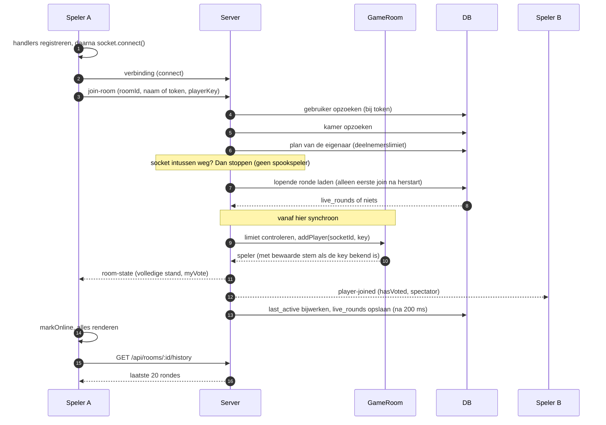
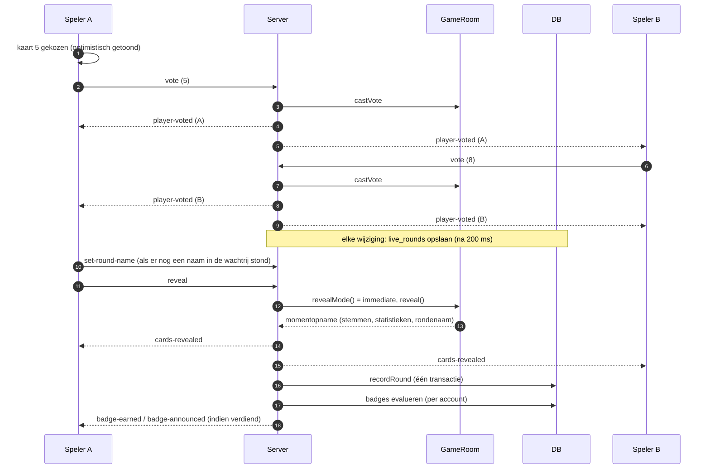
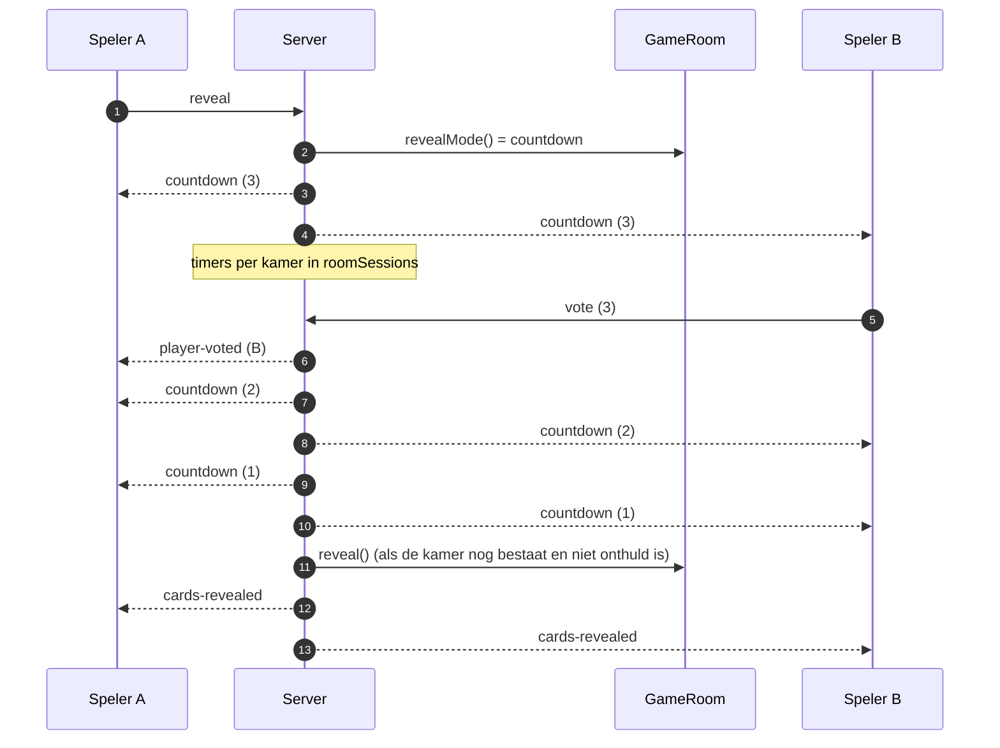
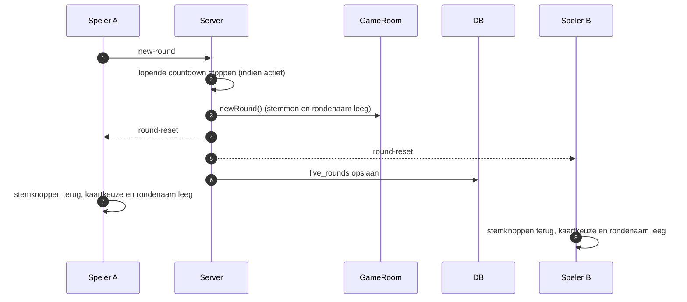
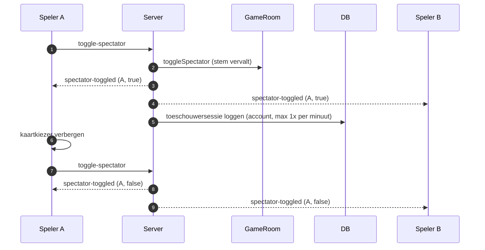
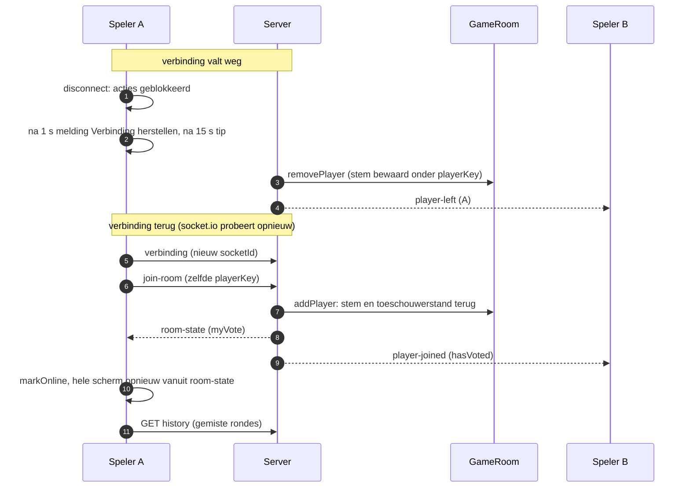
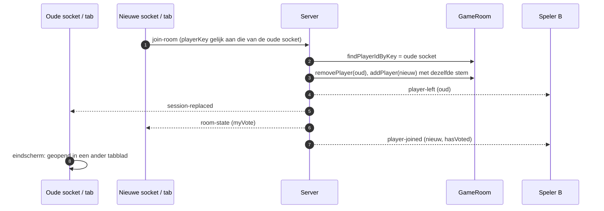
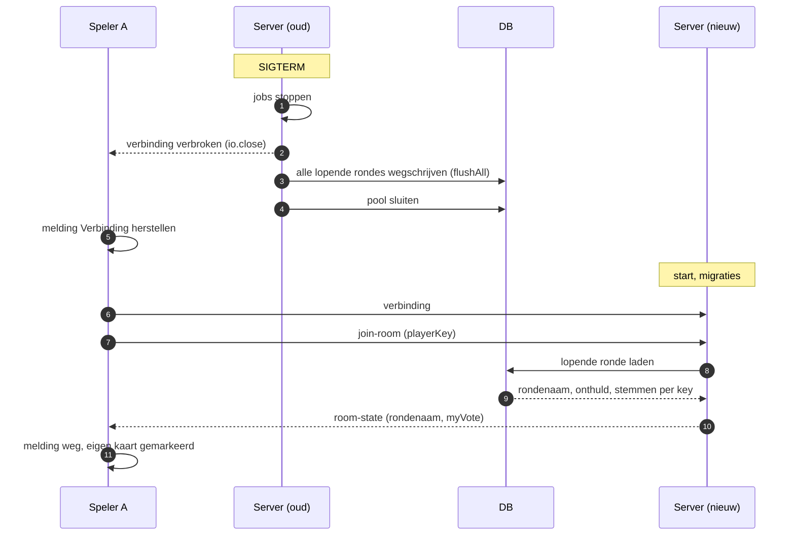
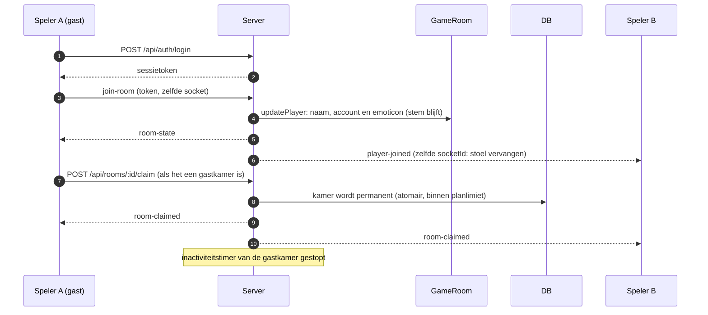
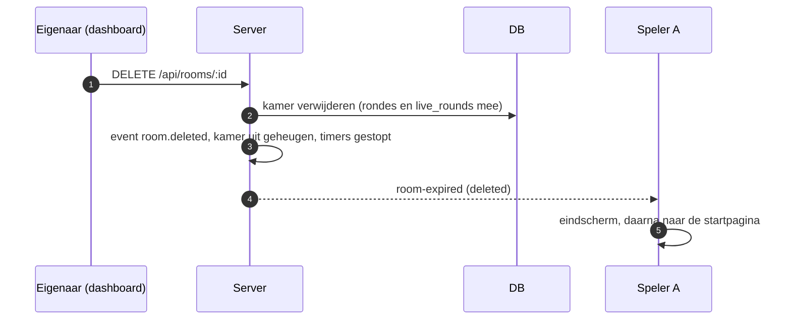

# Spelscenario's — sequence-diagrammen

Dit document beschrijft de volgorde van events tussen de browsers, de server en de database voor elk scenario in een kamer. De diagrammen zijn Mermaid en renderen op GitHub.

**Deelnemers in de diagrammen**

| Naam | Wat |
|---|---|
| Speler A / B | Browser, `frontend/public/js/room/*` |
| Server | Socket-laag, `backend/src/realtime/index.js` + `roomSessions.js` |
| GameRoom | Spelstatus in geheugen, `backend/src/domains/game/gameRoom.js` |
| DB | Postgres (`rooms`, `round_history`, `user_votes`, `live_rounds`) |

**Basisregels**

- De server is de enige bron van waarheid. Een browser past zijn scherm aan op events van de server; alleen de eigen stem wordt optimistisch getoond.
- `room-state` is altijd de volledige stand. Na elke (her)verbinding zet de client álle knoppen en panelen opnieuw vanuit die stand.
- Binnen één socket-handler op de server draait alles na de laatste `await` zonder onderbreking. Controles en wijzigingen die bij elkaar horen staan daarom in zo'n synchroon stuk.
- Spelacties van de client gaan via `send()` en worden alleen verstuurd als de client verbonden én gejoind is.

---

## 1. Kamer joinen

**Naam bepalen (client, vóór stap 3):** account → naam die deze pagina al koos → naam van de landingspagina → onthouden naam → naam-modal. Wordt de naam ingevuld terwijl de verbinding weg is, dan wordt er niets gebufferd; de `connect`-handler joint zodra de verbinding terug is.

**Foutpaden:** `ROOM_NOT_FOUND`, `ROOM_FULL` (met `limit`) en `SERVER_ERROR` tonen een eindscherm; `NAME_REQUIRED` opent de naam-modal.

---

## 2. Stemmen en direct onthullen

Iedereen die geen toeschouwer is heeft gestemd.

- Stemmen van spelers die tijdens de ronde zijn weggevallen tellen mee (in de momentopname met `socketId: null`).
- Een klik op een kaart die de reveal kruist, wordt door de server geweigerd. De client neemt bij `cards-revealed` zijn eigen stem over uit het serverantwoord en haalt een niet-getelde keuze weg.
- Wie niet gestemd heeft krijgt een kaart met "—".

---

## 3. Onthullen met countdown

Nog niet iedereen heeft gestemd.

- Een tweede `reveal` tijdens de countdown wordt genegeerd; per socket geldt bovendien een wachttijd van 2 seconden.
- `new-round` tijdens de countdown stopt de timers: de server stuurt `countdown-cancelled` en daarna `round-reset`.
- Vertrekt de laatste speler, dan stoppen de timers ook.
- Wie tijdens de countdown opnieuw verbindt, krijgt `room-state`; de client verbergt dan een countdown die is blijven staan.

---

## 4. Nieuwe ronde

Bewaarde stemmen van afwezige spelers horen bij de oude ronde en vervallen; afwezige toeschouwers blijven toeschouwer.

---

## 5. Toeschouwer worden en weer meedoen

Wisselen kan alleen zolang de kaarten niet onthuld zijn. Toeschouwers tellen niet mee voor "iedereen heeft gestemd".

---

## 6. Verbinding kwijt en herstellen

**Overname.** Merkt de server de oude socket nog niet als dood (netwerkwissel) of is het tabblad gedupliceerd, dan staat er nog een speler met dezelfde `playerKey` aan tafel:

Een terugkerende speler telt niet mee voor de deelnemerslimiet en krijgt dus geen "kamer vol".

---

## 7. Deploy tijdens een ronde

Niet bewaard: een lopende countdown. Na een disconnect die de server zelf startte, begint de client zelf een nieuwe verbindingspoging.

---

## 8. Inloggen in de kamer en de kamer claimen

Claimen meerdere ingelogde spelers tegelijk, dan wint er één (de `UPDATE … WHERE is_guest`); de anderen krijgen een 409 die de client negeert.

---

## 9. Kamer verwijderd of verlopen

Een gastkamer zonder activiteit krijgt na een uur hetzelfde `room-expired` (reden `inactivity`) en wordt verwijderd. Een lege permanente kamer verdwijnt na 10 minuten alleen uit het geheugen; de lopende ronde blijft in `live_rounds` staan.

---

## Volgorde- en race-situaties

| Situatie | Wat er zonder bescherming gebeurt | Bescherming |
|---|---|---|
| Socket valt weg terwijl `join-room` nog op de database wacht | Spookspeler die nooit meer verdwijnt | Na elke `await` controleert de server `socket.disconnected` |
| Nieuwe socket van hetzelfde tabblad joint terwijl de oude nog "leeft" | Dubbele stoel, stem kwijt, of "kamer vol" bij een volle kamer | Overname op `playerKey`; terugkerende speler telt niet voor de limiet |
| Twee joins tegelijk voor de laatste plek | Limiet met één overschreden | Limietcontrole en `addPlayer` in hetzelfde synchrone stuk |
| Dezelfde socket joint twee keer (naam ingevuld tijdens reconnect, inloggen) | Dubbele stoel bij anderen, stem gewist | Server werkt de speler bij; client vervangt de stoel met hetzelfde `socketId` |
| Client verbindt voordat de handlers geregistreerd zijn | Eerste `connect` gemist, speler joint niet | `autoConnect: false`, verbinden na registratie |
| Actie verstuurd terwijl de verbinding weg is | socket.io buffert en stuurt vóór de nieuwe join; server negeert het | `send()` blokkeert tot verbonden én gejoind |
| Ronde eindigt of begint terwijl een speler offline is | Verkeerde knoppen, vastgelopen countdown, ontbrekende historie | `room-state` zet het hele scherm; historie wordt opnieuw opgehaald |
| Kaart aangeklikt terwijl een ander onthult | Kaart lijkt gekozen maar telt niet | Client neemt eigen stem over uit `cards-revealed` |
| Rondenaam getypt en meteen onthuld | Ronde zonder (volledige) naam opgeslagen | Wachtende naam wordt vóór `reveal` verstuurd; vervalt bij een nieuwe ronde |
| Speler stemt en valt weg vóór de reveal | Stem telt niet, maar verschijnt later wel aan tafel | Stemmen van afwezigen tellen mee; dubbeltelling voorkomen bij terugkeer onder een andere key |
| Twee reveals kort na elkaar | Dubbele ronde in de historie | `reveal()` werkt één keer per ronde; countdown één per kamer; wachttijd per socket |
| Deploy tijdens een ronde | Stemmen weg | `live_rounds`, wegschrijven bij shutdown, herstel bij eerste join |
| Meerdere schrijfacties voor dezelfde kamer | Oudere stand overschrijft nieuwere | Schrijfacties per kamer in volgorde, altijd de laatste momentopname |

**Bekende, geaccepteerde randgevallen**

- Wordt een kamer verwijderd precies tussen het opzoeken en het openen tijdens een join, dan zit die ene speler in een kamer die niet meer bestaat. Opslaan faalt dan (wordt gelogd); na herladen krijgt de speler "kamer niet gevonden".
- Twee gelijktijdige naamswijzigingen van de kamer: in het geheugen wint de laatste, in de database kan de andere als laatste aankomen. Bij de volgende wijziging of herstart trekt dit recht.
- Een gedupliceerd browsertabblad deelt de `playerKey` met het origineel; het nieuwste tabblad neemt de stoel over en het andere stopt.
